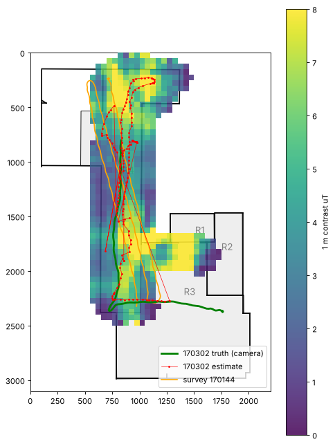

# Office corridor check (2026-11-26) · 办公室走廊数据核对

**English summary.** First office uploads since 2026-11-12: one corridor round-trip survey (65 m, App-calibrated
magnetometer bias, cloud residual 1.8 µT) and two live runs. After the map rebuild the corridor band is essentially fully
covered, while the rooms off the corridor are still ~22 % covered. A cold-start live run tracked the corridor at 1–2 m and
was lost as soon as it walked into an unsurveyed room.

*Colour = 1 m magnetic contrast (µT) of the rebuilt map; orange = today's survey; green = camera ground truth of a live run;
red = the App's estimate.*

## 地图（重建后）

| | 重建前 | 重建后 |
|---|---|---|
| 磁场格子 | 612 | 705 |
| 可走面积覆盖 | 38 % | **41.5 %**（84 / 202 m²） |
| 路线一致性（绿 / 黄 / 红 / 灰） | 15 / 7 / 1 / 3 | **22 / 8 / 0 / 2** |
| 1 m 起伏中位 | 4.4 µT | 4.4 µT |
| 平坦（< 2 µT）占比 | — | 13.6 % |

按区域：走廊带基本 **100 %** 覆盖；走廊外的大房间、厨房和小房间合计约 **22 %**，其中小房间很平（0.9 µT）。
办公室地图还没有地图朝向（mapUpBearing），冷启动的朝向要整圆搜索。

## 实时定位

- 当天两次实时定位用的都是**旧地图**（11/25 版本），所以当天的建图采集还没影响到它们。
- 冷启动一次（64 s，当时开着视觉增强、视觉修正 1 次）对照摄像头真值：**走廊部分 1–2 m**（中位 1.9 m，2 m 以内 53 %）；
  约 50 s 走进没采过的大房间后，估计跳回走廊，误差 14–17 m（P90 17 m）。
- 另一次 16 s 的运行磁力计偏置检查没过（|B| 277 µT），只用了 PDR，不计入。

## 结论

走廊的数据已经齐了；近期变好主要来自走廊覆盖和 App 侧的改动（#77 / #78 / #83），不是这一次采集。
还缺的是三个房间内部和走廊 → 房间的过渡段。判断精度要用**关摄像头的冷启动**实时运行或回放（见 [flat-field-localization.md](../flat-field-localization.md)）。
