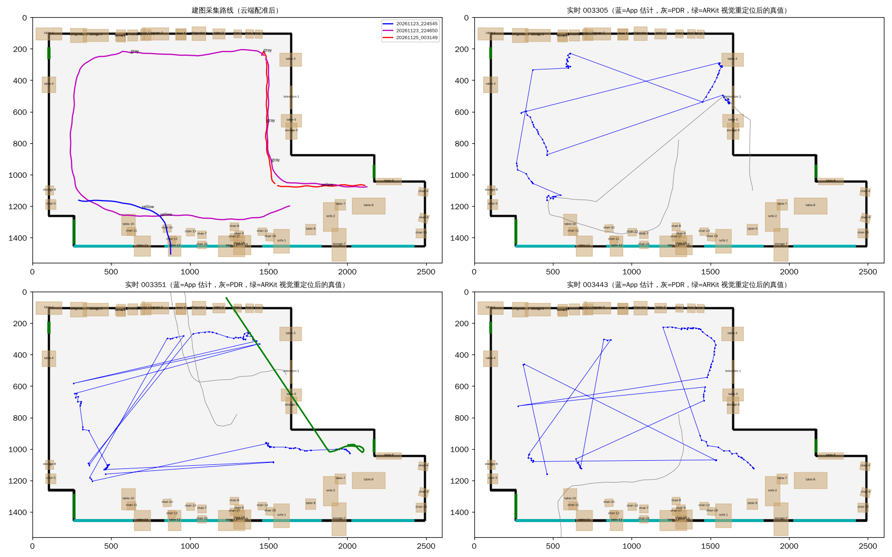

# Test-store drift diagnosis (2026-11-25) · Tesco 测试店漂移诊断

**English summary.** "Accurate in one corner, drifting everywhere else." All three live runs were cold starts on a map whose
magnetic field covered only 23 % of the walkable area (one perimeter loop plus one aisle, no BLE tags). With magnetic-only
cold start allowed on small maps, the estimate jumped 7–12 m within seconds. The one accurate corner was where ARKit
relocalised against the room-scan world map. Follow-ups: PR #83 (App-calibrated magnetometer bias in the map builder,
automatic map-up bearing) and the flat-field study in [flat-field-localization.md](../flat-field-localization.md).

*Top left: survey routes after cloud registration, coloured by route consistency. Other panels: blue = App estimate,
grey = PDR, green = ground truth after ARKit visual relocalisation.*

## 要点

- 地图：可走 199 m²，磁场覆盖 45 m²（23 %）；路线一致性 0 绿 / 3 黄 / 4 灰；没有蓝牙标签。
- 三次实时定位都是冷启动（没点起点），都用的旧地图版本（当天的采集在运行之后才合进地图）。
- 「准的那个角」是 ARKit 对着扫描世界地图重定位成功的地方，误差 0.6–1.1 m；其他地方是磁场太平 + 覆盖太少导致的错定。
- RoomPlan 把货架识别成沙发 / 电视 / 桌子等，地图内部基本是空的，没有货架约束。
- 店里磁场很平：1 m 起伏中位只有 1.2 µT（办公室 4.4 µT），84 % 的地方低于 2 µT。

## 后续

- PR #83：建图用 App 标定的磁力计偏置（地图与实时的 Bz 差 21.7 → 1.3 µT）；房间图自动估地图朝向（Tesco 231°）。
- PR #84：平坦度指标和看板警告；收敛门限实测无效，没加。
- **还需要补采**：内部通道双向走 + 交叉路线，并画出货架几何。
